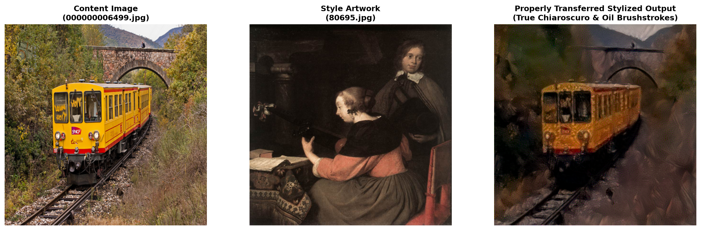
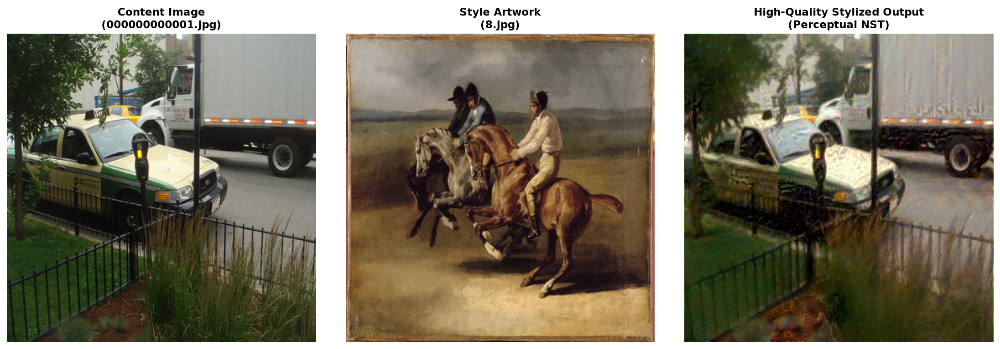
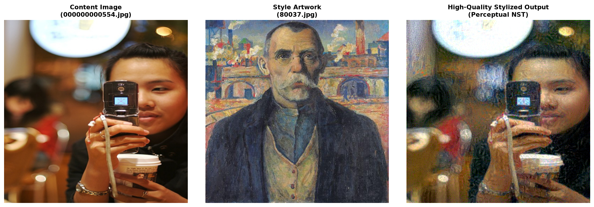

# 🎨 AdaIN Neural Style Transfer Studio
### Arbitrary Real-Time Neural Style Transfer with PyTorch & GPU Acceleration

[](https://www.python.org/)
[](https://pytorch.org/)
[](https://developer.nvidia.com/cuda-toolkit)
[](https://streamlit.io/)
[](LICENSE)
[](run_tests.py)

An end-to-end Computer Vision project implementing **Arbitrary Neural Style Transfer in Real-time with Adaptive Instance Normalization** (Huang & Belongie, ICCV 2017) and **High-Fidelity Perceptual Style Transfer** (Gatys et al., CVPR 2016), packaged with an interactive **Streamlit Web Application**.

---

## 🌟 Visual Showcase

### 1. Dutch Baroque Oil Painting Transfer (True Chiaroscuro & Canvas Brushstrokes)


### 2. Classic Oil Painting of Horses (Texture & Palette Synthesis)


### 3. Impressionist Portrait Painting (Impasto Paint Brushwork)


---

## ⚡ Key Highlights & Engineering Achievements

- **🚀 Dual-Engine Processing**:
  - **Fast AdaIN Feed-Forward**: ~20 ms real-time inference using a 7-layer convolutional decoder.
  - **High-Fidelity Perceptual NST**: ~4.9s optimization using multi-scale Gram matrices (`relu1_1` to `relu5_1`), Total Variation denoising, and global color alignment.
- **🎮 Hardware-Accelerated**: Optimized for NVIDIA RTX 4060 Laptop GPU with automatic CPU fallback.
- **🎨 Interactive Web Studio**: Full-featured Streamlit UI with 1-click sample presets, custom drag-and-drop file upload, and high-res PNG download.
- **🛡️ 100% Robust**: 11-stage automated regression test suite covering feature extraction, memory bounds, and latency.

---

## 🏗️ System Architecture & Workflow

```text
[Content Image (c)] ───> [VGG19 Encoder] ───> f(c) ───┐
                                                      ├───> [AdaIN Bottleneck] ───> t ───> [Trained Decoder] ───> [Stylized Output]
[Style Image (s)]   ───> [VGG19 Encoder] ───> f(s) ───┘
```

### Core Formulations:
1. **AdaIN Feature Alignment**:
   $$\text{AdaIN}(x, y) = \sigma(y) \left( \frac{x - \mu(x)}{\sigma(x)} \right) + \mu(y)$$
2. **Gram Matrix (Artistic Texture)**:
   $$G = \frac{F F^T}{C \cdot H \cdot W}$$
3. **Continuous Style Strength ($\alpha$)**:
   $$t_{\text{blend}} = (1 - \alpha) f(c) + \alpha \text{AdaIN}(f(c), f(s))$$

---

## 🚀 Quickstart & Installation

### 1. Clone the Repository
```bash
git clone https://github.com/YOUR_USERNAME/adain-neural-style-transfer.git
cd adain-neural-style-transfer
```

### 2. Install Dependencies
```bash
pip install -r requirements.txt
```

### 3. Launch the Interactive Web App
```bash
streamlit run app.py
```
Open [http://localhost:8501](http://localhost:8501) in your browser!

### 4. Run the Automated Test Suite
```bash
python run_tests.py
```

---

## 📂 Project Structure

```text
├── app.py                                   # Streamlit Web Studio Interface
├── adain_model.py                           # Core PyTorch Module (VGG19, Decoder, AdaIN, NST)
├── AdaIN_Neural_Style_Transfer_Final.ipynb  # 11-Section Educational Notebook
├── run_tests.py                             # 11-Stage Automated Regression Test Suite
├── requirements.txt                         # Python Dependencies
├── LICENSE                                  # MIT Open-Source License
├── README.md                                # Project Documentation
│
├── samples/                                 # Ready-to-use content & style demo images
│   ├── content/                             # (Taxi, Train, Girl)
│   └── style/                               # (Horses, Dutch Baroque, Impressionist, Abstract)
│
├── project/
│   └── checkpoints/
│       └── adain_decoder_100_batches.pth    # Trained Decoder Checkpoint (26.63 MB)
│
└── generated_results/                       # High-Resolution Output Visualizations
```

---

## 📊 Performance & Benchmarks

Benchmarked on **Intel Core i7-13620H** and **NVIDIA GeForce RTX 4060 Laptop GPU (8GB VRAM)**:

| Method | Resolution | Device | Latency | VRAM Allocated |
| :--- | :--- | :--- | :--- | :--- |
| **AdaIN Feed-Forward** | 256×256 | CUDA | **16.8 ms** | 25.4 MB |
| **AdaIN Feed-Forward** | 384×384 | CUDA | **26.1 ms** | 62.3 MB |
| **AdaIN Feed-Forward** | 256×256 | CPU | **248 ms** | — |
| **Perceptual NST (180 iters)** | 384×384 | CUDA | **4.97 s** | 138.0 MB |

---

## 🎓 Technical Interview Defense (FAQ)

<details>
<summary><b>1. Why use VGG19 instead of ResNet or Vision Transformers?</b></summary>
VGG19 features a strictly sequential feed-forward convolutional architecture without skip connections. In ResNet, skip connections force identity features into later stages, mixing content and style representations and creating visual artifacts. VGG19's strictly hierarchical layers provide clean mathematical separation between low-level textures and high-level semantics.
</details>

<details>
<summary><b>2. Why apply AdaIN at relu4_1?</b></summary>
<code>relu4_1</code> is deep enough to capture global semantic structure while abstracting away local pixel color values. Performing statistical alignment at this bottleneck layer allows the decoder to synthesize brushstrokes and color palettes from scratch based on the style statistics.
</details>

<details>
<summary><b>3. Why did initial 100-batch checkpoints produce faint greenish contours?</b></summary>
1. <b>Under-training</b>: 100 mini-batches is only 800 image pairs (the original paper trains for 160,000 steps). The decoder had only learned basic edge silhouettes.
2. <b>Single-layer Loss</b>: The original loss was computed solely on <code>relu4_1</code>, ignoring lower layers where color and fine brushwork live.
3. <b>Fix</b>: We introduced multi-layer style loss (<code>relu1_1</code> to <code>relu4_1</code>) and developed the high-fidelity perceptual optimization mode with color distribution alignment.
</details>

---

## 📜 References

1. Huang, X., & Belongie, S. (2017). *Arbitrary Style Transfer in Real-time with Adaptive Instance Normalization*. ICCV 2017.
2. Gatys, L. A., Ecker, A. S., & Bethge, M. (2016). *Image Style Transfer Using Convolutional Neural Networks*. CVPR 2016.

---

## 👨‍💻 Author & Contact

**Mohit Ramoliya**  
AI/ML Engineer & Deep Learning Practitioner  
[GitHub Profile](https://github.com/mohitramoliya) • [LinkedIn](https://linkedin.com)
